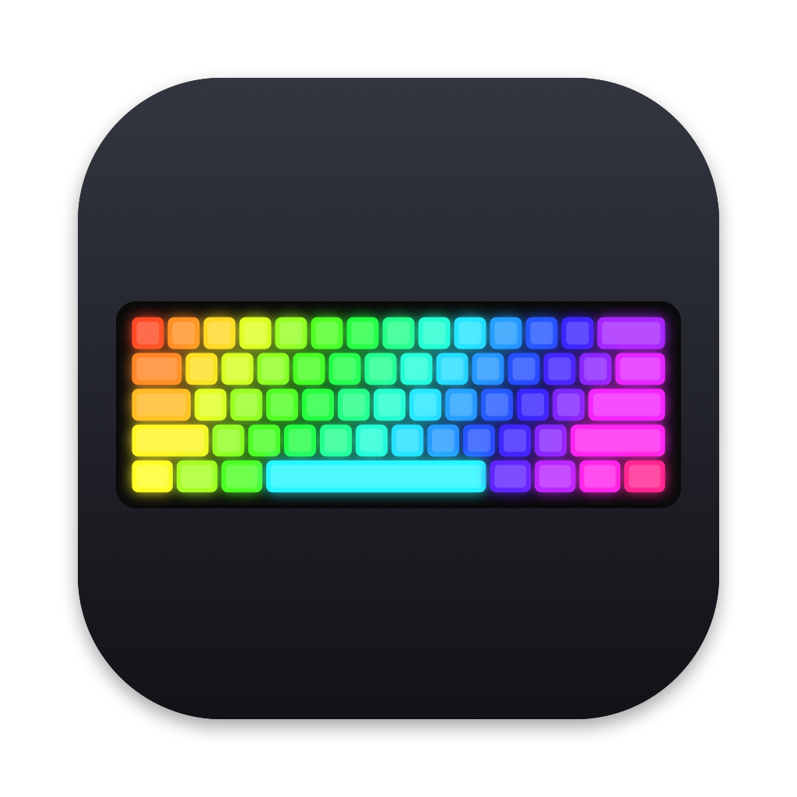

<p align="center">
  
</p>

<h1 align="center">Anne Pro for Mac</h1>

<p align="center">
  Change the lighting and layout of the <b>original Anne Pro</b> keyboard over Bluetooth,<br>
  from a modern, native macOS menu bar app.
</p>

---

The official Anne Pro apps are long gone. This is a from-scratch rewrite for current macOS (Apple Silicon and Intel), built on the protocol work of earlier community projects and tested against a real keyboard.

## Features

- **Menu bar controls**: switch lighting modes (solid colours, breathing, rainbow, reactive, ripple…), brightness, and layout (Windows, Windows + arrows, Mac, Custom) in one click.
- **Per-key lighting editor**: paint keys by clicking or dragging, fill groups, use presets, ⌥-click to pick up a colour. The preview shows what the keyboard will really display.
- **Custom layout editor**: remap any key on the base and Fn layers. It won't let you upload a layout that would lock you out (no Fn or Anne key).
- **Reliable uploads**: every upload is read back from the keyboard and retried until it sticks.
- **Battery level**, automatic reconnect when the keyboard wakes, Open at Login, and an option to hide the menu bar icon.
- **Import / export** profiles as JSON. It also reads files exported by the old AnnePro-mac app.
- **`anne` command-line tool** for scripting and debugging.

## Requirements

- An **original Anne Pro** (2016–2018, micro-USB). The Anne Pro 2 uses a different protocol and is not supported.
- macOS 13 Ventura or later, on Apple Silicon or Intel.
- The keyboard paired with your Mac over Bluetooth in **BLE mode**. It shows up as `ANNE_KB_L0_…` in Bluetooth settings (`L0` means BLE).

## Install

1. Download `AnnePro-x.y.z.zip` from [Releases](../../releases/latest), unzip it, and move **AnnePro.app** to Applications.
2. Open it. The app isn't notarized by Apple (it's a free hobby project), so macOS blocks it the first time:
   - **macOS 15 and later:** click **Done**, then go to **System Settings → Privacy & Security**, scroll down and click **Open Anyway**.
   - **macOS 13–14:** right-click the app, choose **Open**, then **Open** again.
   - **Or, in Terminal:** `xattr -dr com.apple.quarantine /Applications/AnnePro.app`
3. Allow Bluetooth access when macOS asks.

Anne Pro lives in the menu bar: click the keyboard icon at the top of the screen. Opening the app again shows the same controls in a window.

Don't need it all the time? Uncheck **Show in Menu Bar**. Anne Pro then works like a normal app: open it when you want to change something, and quit it when you're done. The keyboard keeps its settings either way.

## Command-line tool

```console
$ anne status
Connected to ANNE_KB_L0_XXXX
Model:    Anne Pro
Battery:  100%
Layout:   Windows
Lighting: Cyan

$ anne mode rainbow
$ anne brightness 6
$ anne fill "#00A0FF"            # every key one colour (switches to Custom)
$ anne read-lighting mine.json   # back up your custom lighting
$ anne write-layout mac          # put the Mac layout in the Custom slot and use it
$ anne raw 09 01 08 -v           # send raw bytes, print every packet
```

Run `anne help` for everything. The first time you use it, macOS asks to give your terminal app Bluetooth access.

## Troubleshooting

| Problem | Fix |
|---|---|
| "Looking for your Anne Pro…" forever | Make sure the keyboard is paired and connected in System Settings → Bluetooth, then press a key to wake it. |
| Keyboard not listed as `ANNE_KB_L0_…` | It's in legacy Bluetooth mode. Switch it to BLE (see the Anne Pro manual), then re-pair. |
| "Bluetooth access not allowed" | System Settings → Privacy & Security → Bluetooth → enable Anne Pro (or your terminal for `anne`). |
| Colours look dimmer than picked | The keyboard dims any key whose R+G+B exceeds 450 to 60% to protect its LEDs. The editor preview shows this. |
| Switching to Custom layout is refused | The keyboard's custom slot is empty or broken. Open the layout editor, start from a preset and send it first. |

## Building from source

Only the Xcode Command Line Tools are needed (`xcode-select --install`); full Xcode works too.

```sh
swift build                  # everything
scripts/test.sh              # unit tests
scripts/build-app.sh         # universal, signed dist/AnnePro.app + zips
```

The project is a Swift package:

| Module | What it is |
|---|---|
| `AnneProKit` | The protocol: packets, checksum, key map, lighting and layout data. Pure Swift, fully unit tested. |
| `AnneProBluetooth` | CoreBluetooth connection: discovery, reconnects, write pacing, verified uploads. |
| `AnneProApp` | The SwiftUI menu bar app. |
| `anne` | The command-line tool. |

The wire protocol, including quirks found while testing on hardware, is documented in [docs/PROTOCOL.md](docs/PROTOCOL.md). Release steps are in [docs/RELEASING.md](docs/RELEASING.md).

## Credits

This project would not exist without the people who reverse-engineered the keyboard:

- [msvisser/AnnePro-mac](https://github.com/msvisser/AnnePro-mac): the original macOS app (2017). The factory layouts and protocol constants come from there.
- [kprinssu/anne-keyboard-windows](https://github.com/kprinssu/anne-keyboard-windows): the Windows app, ported from the official Android app.
- [ah-/anne-key](https://github.com/ah-/anne-key): open-source firmware whose source documents the message types.

Anne Pro is a trademark of Obins. This project is not affiliated with or endorsed by Obins.

## License

MIT. See [LICENSE](LICENSE) and [THIRD_PARTY_NOTICES.md](THIRD_PARTY_NOTICES.md).
